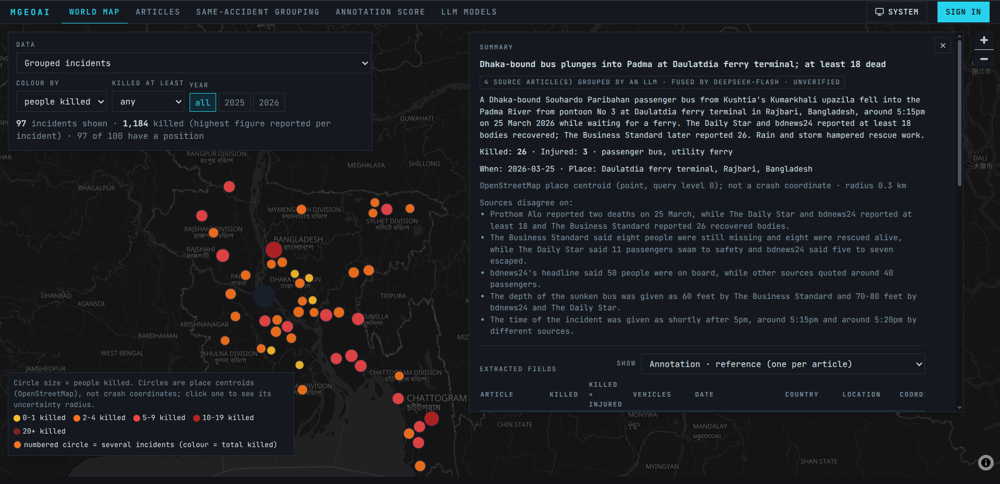

# MGeoAI

Road-accident news, read by language models and by people, compared, grouped into incidents and put on a map.

- **Extraction:** an LLM reads each saved article (cleaned to markdown, optionally with images) and returns one
  schema-checked JSON record per accident: deaths, injuries, vehicles, date, country, location, with word-for-word evidence.
- **Annotation:** people fill the same fields blind; one annotation per article is the reference.
- **Scoring:** annotation agreement, per-model accuracy, and a model-vs-annotator report.
- **Same-accident grouping benchmark:** which articles describe the same accident (LLM pair judges, LLM clustering,
  word-similarity and rule baselines).
- **Map:** one circle per accident, with a fused summary and a place-centre location (never a crash coordinate).

It fuses evidence; it does not verify truth or decide fault.



Live site: <https://mgeoai.cartmind.xyz> · Dataset: <https://huggingface.co/datasets/hamimmahmud0/mgeoai-road-accident-news> (CC BY 4.0)
· **How it works, in plain language: [METHODOLOGY.md](METHODOLOGY.md)**

## Reproduce the reports

```bash
pip install -e '.[dev]'
mgeoai x reproduce --dataset hamimmahmud0/mgeoai-road-accident-news --output reproduced/
# same thing: scripts/reproduce_reports.sh
```

Needs no API key and no article text. Writes `annotation_scores.json`, `model_performance.json`,
`grouping_results.json`, `grouping_report.html`, `model_vs_annotators.html`, `incidents.geojson`, and checks the
grouping numbers against the published ones.

## Layout

| Path | What |
|---|---|
| `src/traffic_fusion/extraction/` | Preparation, providers, runs, scoring, grouping, incidents, geocoding, backup, dataset export and reproduce |
| `src/traffic_fusion/api/` | FastAPI app: public reads, sign-in, annotation and control-panel routes |
| `web/` | React / Vite / Tailwind / MapLibre site (`web/dist` is committed for deployment) |
| `assets/mllm_prompts/` | The versioned extraction prompt |
| `benchmark/` | Source lists and the page collection scripts |
| `docs/` | Dataset card, grouping benchmark notes, backup bucket README |
| `journal/` | Work log |

## Run it

```bash
python -m pip install -e '.[dev]'
cd web && npm install && npm run build && cd ..
export MGEOAI_EXTRACTION_DIR=extraction          # data root: articles/, labels/, runs/, matching/
mgeoai x init-accounts --root extraction          # passwords go to a private file, never printed
mgeoai serve --host 127.0.0.1 --port 8000
```

Model keys are entered in the control panel (kept in server memory only) or set in the environment; see `.env.example`.
Useful commands: `mgeoai x --help` (run models, group benchmark, build incidents, backup, export dataset, reproduce).

## Checks

```bash
pytest && ruff check src tests && mypy src/traffic_fusion
cd web && npm test && npm run lint && npm run build
```

## Data and licence

Code: see `LICENSE`. The dataset (annotations, model extractions, grouping labels and predictions, incident summaries)
is CC BY 4.0. Article text and images belong to their publishers and are not redistributed. Place coordinates are
© OpenStreetMap contributors (ODbL).
