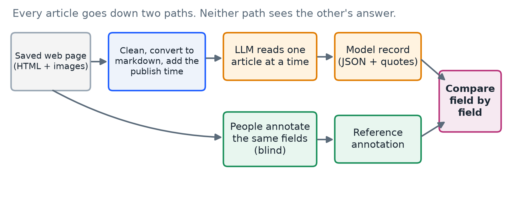
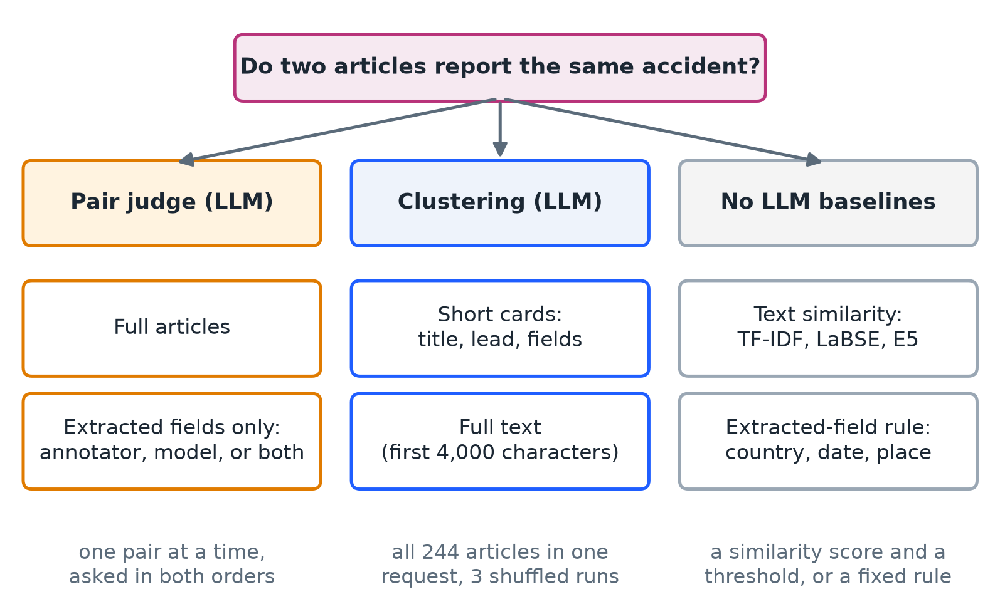
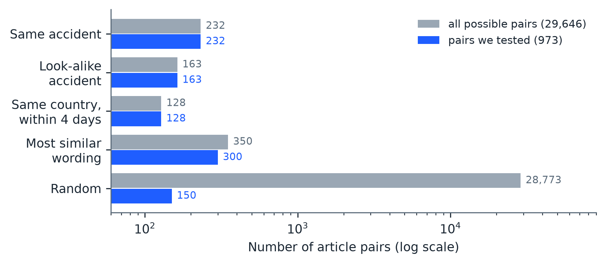
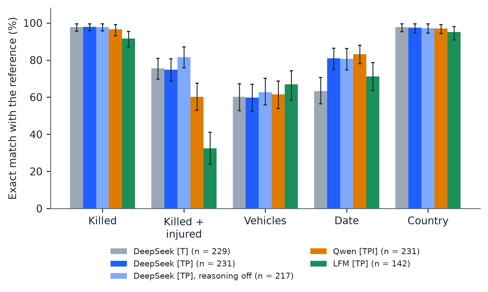
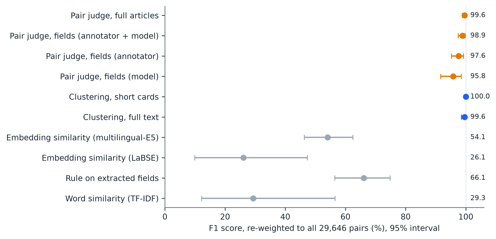

**MGeoAI: Extracting Road-Accident Facts and Recognizing Repeated Reports of the Same Accident in Online News with Large Language Models**

Hamim Mahmud, S.M. ASCE^1^; Oishik Majumder, S.M. ASCE ^2^; Mubasshir Bin Shahid, S.M. ASCE ^3^; Md. Azijul Islam, M. ASCE, Ph.D.^4^; and Shofiq Ahmed^5^

¹B.Sc. Student, Department of Civil Engineering, Bangladesh University of Engineering and Technology (BUET), Dhaka 1000, Bangladesh. Email: [2104065@ce.buet.ac.bd](mailto:2104065@ce.buet.ac.bd)

² B.Sc. Student, Department of Civil Engineering, Bangladesh University of Engineering and Technology (BUET), Dhaka 1000, Bangladesh. ORCID: https://orcid.org/0009-0006-4530-1992. Email: [oishikm76@gmail.com](mailto:oishikm76@gmail.com)

³ B.Sc. Student, Department of Civil Engineering, Bangladesh University of Engineering and Technology (BUET), Dhaka 1000, Bangladesh Email: [mubasshirbinshahid3@gmail.com](mailto:mubasshirbinshahid3@gmail.com)

^4^ Assistant Professor, Department of Civil Engineering, Bangladesh University of Engineering and Technology (BUET), Dhaka 1000, Bangladesh. ORCID: https://orcid.org/0000-0003-2603-7031. Email: [azijul@ce.buet.ac.bd](mailto:azijul@ce.buet.ac.bd)

^5^Shofiq Ahmed, Executive Vice President, Peggy Malone & Associates. Email: <sahmed@peggymalone.com>

ABSTRACT

News articles are a fast source of road-accident information, but the same accident is often reported by several outlets in different words and languages, and the numbers change as the story develops. This paper tests two questions on 244 saved news articles about 100 road accidents (124 articles from Bangladesh, 120 from other countries; English and Bengali). First, how well can a large language model (LLM) pull out accident facts such as deaths, vehicles, date, and place? Second, how well can an LLM tell which articles describe the same accident? Three of the authors annotated the articles by hand, without seeing any model output, to provide a reference. A DeepSeek model that was given the article text and its publication timestamp matched the reference on the number of people killed in 97.8% of 231 single-accident articles (95% bootstrap interval 95.9% to 99.6%) and on the country in 97.4%. Dates matched in 81.0% of articles when the timestamp was supplied, and in only 63.3% when it was not. Turning the model's reasoning off made it about five times faster and slightly better on the killed-plus-injured total, but worse on dates, and one answer in twelve then broke the required format. A self-hosted Qwen model was similar except for the killed-plus-injured total, where it was 14.7 percentage points lower. A small edge model that can run on consumer hardware gave a valid answer for only 59.4% of articles. For same-accident identification, DeepSeek reading short article summaries and grouping all articles in one request recovered all 100 accidents exactly. Judging pairs of full articles reached an F1 score of 99.6%, against 54.1% for multilingual sentence embeddings, 66.1% for a rule on extracted fields, and 29.3% for word similarity. An error analysis shows that most extraction errors are dates left empty, injured people left out of totals, and extra vehicles listed. The reference groups were found partly with an AI agent and then checked by three of the authors. The data, code, and a script that recreates every table and figure are public.

# 1. INTRODUCTION

Road traffic injury remains a major global public-health and transportation-safety problem. The World Health Organization estimated approximately 1.19 million road deaths in 2021 and identified road traffic injury as a leading cause of death among children and young adults (World Health Organization 2023). Good crash data are needed to find dangerous locations, test safety measures, and plan emergency response. Yet official data can be late or incomplete, especially in low- and middle-income countries.

News articles can fill part of this gap. A newspaper often reports an accident within hours and states the number of dead, the vehicles involved, and the place. Earlier transportation research showed that social-media posts can help detect traffic events (Gu, Qian, and Chen 2016; Ali et al. 2021), and recent work uses large language models to turn free text into structured records (Xu et al. 2024; Schwitter 2025). Two practical problems remain before news can be used as accident data.

The first problem is **extraction**: can a language model read one article and write down the facts correctly? An error here, such as a wrong death count, goes straight into the data. The second problem is **repeated reporting**: the same accident is usually covered by several outlets, in different languages, with different details and different death tolls as the story develops. If these articles are not recognized as one accident, the accident is counted several times. If different accidents are wrongly merged, accidents are lost. Cross-document event extraction and event coreference research addresses this second problem in general news (Leban et al. 2014; Gao et al. 2024; Nath et al. 2024).

An earlier version of this work built a rule-based and LLM-assisted pipeline and tested it on six incidents. That test was too small to support conclusions, and it could not show whether the LLM helped. We therefore rebuilt the study around a larger, hand-annotated set and a simpler pipeline in which the LLM reads the article directly. This paper answers four questions:

1. How closely do LLM extractions agree with a human annotation, field by field?
2. Does giving the model the article's publication timestamp or its images, or letting it reason before answering, change the result?
3. How well can an LLM decide which articles report the same accident, and how does this compare with simpler methods that need no LLM?
4. How far can extraction be pushed toward low cost, by switching reasoning off or by using a small edge model that runs on consumer hardware?

The contributions are:

- A public set of 244 articles with 328 human annotations, model extraction records from several runs, 973 labeled article pairs, and 100 accident groups, shared without article text because the text belongs to the publishers.
- A field-by-field evaluation of three LLMs of different size and cost (DeepSeek, Qwen, and the edge model LFM3-1.7B) against the human reference annotation, with chance-corrected agreement, a test of reasoning on and off, and an error analysis.
- A comparison of eight ways to find articles about the same accident, including LLM pair judging, LLM clustering, and baselines that need no LLM (multilingual embeddings, word similarity, and a rule on extracted fields).
- An open script that downloads the public dataset and recreates every number, table, and figure in this paper.

The system fuses evidence; it does not decide what is true or who is at fault. A death count is recorded as "what this article says."

# 2. RELATED WORK

## 2.1 Detecting Traffic Incidents from Open Data

Early work showed that social-media text can complement physical traffic detectors. Gu et al. (2016) built real-time incident detection from Twitter posts, and Ali et al. (2021) combined social-network data with accident detection and condition analysis. AlDhanhani et al. (2023) showed that combining several kinds of signals helps traffic-event detection. These studies mainly detect or classify events. They do not ask which of several reports describe the same accident, or how well a model reads the details of each report.

Newspapers have also served directly as a crash-data source in Bangladesh. Bhuiyan et al. (2022) compiled 441 crashes reported in three newspapers for 2019 and used them for severity analysis, noting that newspaper data lean toward severe crashes. Chowdhury et al. (2024) combined web scraping with LLMs to build a Bangladeshi accident dataset and compared GPT-4, GPT-3.5, and Llama-3 on 195 manually annotated reports. Our study adds a second language (Bengali), reports outside Bangladesh, a human-agreement yardstick, and the question of repeated reports.

Under-reporting is the reason such alternative sources matter. Police files capture only part of road casualties: in one French county only about 38% of casualties in a trauma registry appeared in police records, with slight injuries and motorcyclists least covered (Amoros et al. 2006), and in Queensland, Australia, about two-thirds of road crash injuries in hospital data did not link to any police record (Watson et al. 2015). News reports can fill part of the gap: in Yaoundé, Cameroon, newspapers recorded 480 road traffic injuries, against 273 in police records and 1,686 in a hospital trauma registry, and they captured mass-casualty events that the other sources missed (Juillard et al. 2017).

## 2.2 LLMs for Information Extraction

Generative information extraction uses LLMs to map free text to entities, events, and structured fields (Xu et al. 2024). Schwitter (2025) showed in a proof of concept that LLMs can extract predefined information from noisy historical newspaper text. In transportation, Grigorev et al. (2025) combined LLM-derived features with conventional machine learning to classify traffic-incident severity. Mumtarin et al. (2023) compared ChatGPT, BARD, and GPT-4 on 100 police crash narratives and found that agreement among the models was highest for direct yes-or-no questions and lower for complex ones. These studies motivate our extraction test, but they do not compare the model output against independent human annotation on accident articles in several languages and countries. Work in transportation safety now applies LLMs widely: Zhen et al. (2024) used chain-of-thought prompting with GPT-3.5 and LLaMA3 models to infer crash severity from narratives, and Wandelt et al. (2024) reviewed more than 130 papers on LLMs for intelligent transportation, including safety.

## 2.3 Linking Reports of the Same Event

Event coreference means deciding whether two documents describe the same real-world event. News systems have long clustered related stories (Leban et al. 2014). More recent work formalizes cross-document event extraction (Gao et al. 2024) and adds visual information to event coreference (Nath et al. 2024). Multimedia event extraction shows that images can add information that text lacks (Li et al. 2020), and recent work applies multimodal language models to crash video (Zhang et al. 2025). The usual first alternative to an LLM for this problem is a sentence embedding, which turns a text into a list of numbers so that similar texts get similar numbers. Multilingual models such as LaBSE (Feng et al. 2022) and multilingual E5 (Wang et al. 2024) place different languages in one shared space (see also Reimers and Gurevych 2019). Bengali is a lower-resource language, for which dedicated models such as BanglaBERT (Bhattacharjee et al. 2022) were needed to close the gap with English. We therefore include embedding similarity as a baseline. We build on this line of work but test it on a narrow, practical case: road-accident articles where the death toll, wording, and language can differ even though the accident is the same.

# 3. METHODOLOGY

Figure 1 shows the overall design. Each saved article is processed along two separate paths. On one path an LLM reads the article and fills in a fixed set of fields. On the other path a person fills in the same fields without seeing the model's answer. The two records are then compared. A separate experiment, described in Section 3.7, tests methods for finding articles that report the same accident.

{width=6.3in}

## 3.1 Terms Used in This Paper

We explain each technical term here, and again where it first matters.

- **LLM (large language model):** a program that reads text and writes text in reply. We use DeepSeek, Qwen, and LFM.
- **Prompt:** the written instructions given to the LLM. Ours is saved in the public repository.
- **Token:** the unit an LLM reads and writes, roughly three-quarters of an English word. Costs and limits are counted in tokens.
- **Temperature:** a setting for randomness. At 0 the model always picks its most likely answer, so repeated runs are more alike. We use 0.
- **Reasoning (thinking):** some models write hidden reasoning before the final answer. It can help accuracy but uses many more tokens and time. We tested DeepSeek, and the small LFM model, with reasoning on and off.
- **JSON and schema:** JSON is a strict text format for structured data. A schema lists the allowed fields and values. An answer that breaks the schema is rejected.
- **Annotator and reference:** an annotator is a person who fills in the fields by hand. The reference is the annotation we treat as the correct answer when scoring.
- **Edge model:** a small model that can run on an ordinary or consumer device, which lowers the cost of running it at scale. Our edge model, LFM3-1.7B, has 1.7 billion parameters.
- **Quantization:** storing a model's numbers with fewer bits, so that it fits on smaller hardware. It saves memory and usually costs a little accuracy. Our Qwen model uses 4-bit quantization (called Q4).
- **Markdown:** plain text with light formatting such as headings and paragraphs. It keeps the reading order of a web page but drops the page layout.

## 3.2 Data Collection

We chose 100 road accidents: 50 from Bangladesh and 50 from the rest of the world. For each accident we searched the web for news articles that report it, with the help of a browser-based AI agent for finding candidates. Every group of articles was then checked by the three annotating authors. For every article we saved:

- the publishing website and URL;
- the publication date and time;
- a markdown version of the article part of the page, made from its HTML; and
- every image in the article.

The result is 244 articles from 102 publishers: 208 in English and 36 in Bengali; 124 about Bangladesh and 120 about other countries (Table 1). The 100 accidents are covered by between one and four articles each, 2.44 articles per accident on average. In each half (Bangladesh and international), 30 accidents form the main set (usually three or four articles each, 192 articles in all). The other 20 accidents per half were chosen on purpose as look-alikes of the main ones, to make the same-accident task harder, and have one or two articles each (52 articles in total; Table 1). In total 236 articles carry at least one image, and 631 images were saved.

: **Table 1. Composition of the study set.**

| Characteristic | Value |
|:--|:--|
| Articles | 244 |
| Publishers | 102 |
| Languages | English 208, Bengali 36 |
| Regions | Bangladesh 124, international 120 |
| Accidents (groups of articles) | 100: 50 Bangladesh, 50 international |
| Main accidents / look-alike accidents | 60 (192 articles) / 40 (52 articles) |
| Articles per accident | 1 article: 28 groups; 2: 16; 3: 40; 4: 16 |
| Articles with at least one image | 236 (631 images in total) |
| Human annotations | 328 by 3 annotators |
| Reference annotation written by | Annotator A 166, Annotator B 76, Annotator C 2 |

## 3.3 Preparing an Article for the LLM

A saved web page is mostly not the article. It contains menus, advertisements, "related news" lists, scripts, and a header showing today's date. If all of this is sent to a model, tokens are wasted and mistakes become likely, for example when the model copies the death toll from a related headline. Each page is therefore prepared in these steps:

1. **Clean the HTML.** Scripts, styles, forms, buttons, embedded frames, and vector graphics are removed. Scripts are never run. Navigation bars, page headers, footers, and sidebars are also removed.
2. **Convert to markdown.** The cleaned page becomes markdown, which is much shorter than the HTML.
3. **Add the publication timestamp.** The publication timestamp found on the page is added in a labeled block, with a warning that it may be wrong and is not the accident date. It is there only so that the model can turn "last night" or "on Friday" into a date.
4. **Attach images (one model only).** For the run that used images, up to three images per article were sent, resized so that the longest side is 1,024 pixels.
5. **Mark the article as data.** The text is placed between `<ARTICLE_SOURCE>` markers, and the prompt states that everything inside is data, not instructions. This reduces the risk of *prompt injection*, in which a web page contains text such as "ignore your instructions."

The model never sees the annotators' answers or the group an article belongs to.

## 3.4 What Is Extracted

For every article the model, and each annotator, decides whether the article is usable and whether it reports a specific road accident. For each accident, they then fill in the fields in Table 2. An article can report several accidents, in which case several records are produced. A field is left empty (`null`) when the article does not say. The prompt forbids guessing, and it forbids inferring who was at fault. For every image the model also states whether it shows an accident and describes what is visible, and annotators did the same.

: **Table 2. Fields extracted from each article.**

| Field | Meaning | Rule given to the model |
|:--|:--|:--|
| Accident | Is this a specific, real road accident? | False for statistics roundups, policy news, old court cases, and non-road incidents |
| Killed | People killed | The latest explicit figure, including later deaths in hospital |
| Killed + injured | People killed or injured | Killed plus surviving injured, without double counting; for a vague "many injured," the known minimum |
| Vehicles | Types of vehicle involved | From a fixed list (for example car, bus, truck, motorcycle, CNG autorickshaw) or "other: name" |
| Date | When the accident happened | Not the publication timestamp; relative terms resolved from the dateline or publication timestamp |
| Country | Country of the accident | Full English name |
| Location | Place, from most to least specific | Only parts the article states |
| Coordinates | Latitude and longitude | Only if printed in the article, never from the model's memory |
| Evidence | Support for each non-empty field | A quote copied word for word from the article |

## 3.5 Human Annotation and the Reference

Three of the authors annotated the articles. They filled in the same fields as the model, from the original web page, without seeing any model output. Every one of the 244 articles has at least one annotation. The reference is one annotation per article: the annotation of the first annotator, in the fixed order A, B, C, who labeled that article (Annotator A wrote 166 of the 244 reference annotations, Annotator B 76, and Annotator C 2).

All 244 reference annotations were judged usable. Of these, 240 describe exactly one accident, three describe two, and one describes five. The annotators entered no coordinates, so coordinates are not scored.

## 3.6 How the Models Were Run

Each article was sent to the model in one request. The prompt (1) tells the model to find the article body and ignore menus and related headlines, (2) asks whether the article reports a specific road accident, (3) lists the fields and rules in Table 2, and (4) requires a JSON answer only. All runs use temperature 0 and the same prompt.

We name each configuration by the model, followed in square brackets by what the model is given: **T** is the article text, **P** is the publication timestamp, and **I** is images. A note after the brackets states the reasoning setting when it is not the provider's default. For example, "DeepSeek [TP], reasoning off" is DeepSeek given the article text and publication timestamp, with reasoning turned off (Table 3). The configurations differ in one factor at a time where possible: [T] against [TP] tests the timestamp, and "reasoning on" against "reasoning off" tests reasoning.

: **Table 3. Model configurations evaluated. T = article text, P = publication timestamp, I = images. All runs use temperature 0 and the same prompt.**

| Label | Model and access | Input | Reasoning | Output limit | Run date |
|:---------------|:----------------------------:|:---------------:|:---------:|:---------:|:---------:|
| DeepSeek [T] | DeepSeek API, model identifier `deepseek-flash` as returned by the API | Article text | On (provider default) | Provider maximum | 20 Oct 2026 |
| DeepSeek [TP] | same | Text + publication timestamp | On (provider default) | Provider maximum | 8 Nov 2026 |
| DeepSeek [TP], reasoning off | same | Text + publication timestamp | Off | Provider maximum | 10 Nov 2026 |
| Qwen [TPI] | Qwen3.8-27B, 4-bit (Q4) quantization; hosted by the authors behind an OpenAI-compatible endpoint | Text + timestamp + up to 3 images | Off | 8,192 tokens | 8--9 Nov 2026 |
| LFM [TP] | LFM3-1.7B (1.7 billion parameters); hosted by the authors on two NVIDIA T4 GPUs behind an OpenAI-compatible endpoint | Text + publication timestamp | Off | 2,048 tokens | 10 Nov 2026 |

The three models cover a range of size and cost. DeepSeek is a large model reached through a paid web interface. Qwen3.8-27B is a mid-size model that we host ourselves in compressed 4-bit form, so its scores describe the compressed model. LFM3-1.7B is an edge model: at 1.7 billion parameters it is small enough to run on a consumer device, which is what makes it attractive for cheap, large-scale use. We hosted it on two NVIDIA T4 graphics cards. It handles two requests at a time, so articles were sent two at a time. The output limit for DeepSeek was set to the maximum the provider allows so that reasoning could not cut an answer short; in practice DeepSeek wrote about 2,900 tokens per article with reasoning on and about 450 with it off. A free MiniMax model reached through OpenRouter was also tried, but the free service refused most requests and only 72 articles finished, so it is not reported.

We also tried the edge model with reasoning on (output limit 16,384 tokens). Answers with reasoning take longer than the 100 seconds that the tunnel in front of our server allows, so five of six test requests were cut off by the tunnel and the sixth failed the format check. No valid reasoning-on run could be obtained for the edge model, so the effect of reasoning is reported only for DeepSeek.

Every answer is checked before it is accepted. It must follow the schema (allowed field names, number ranges, date format, vehicle list), and each evidence quote must appear word for word in the article. A call that breaks these rules, or that is cut off at the output limit, counts as a failure of the model. A failed call stays marked as failed, and the system never switches to another model. Network timeouts are a different matter: the tunnel in front of our own server closes a request after 100 seconds, and such timeouts were repeated and are not counted as failures of the model.

## 3.7 Finding Articles About the Same Accident

The same accident is often reported by several outlets. To count accidents once, we need to know which articles belong together. We define two articles as **the same accident** when they describe the same crash: the same vehicles, place, and time. They may differ in language, wording, level of detail, and death toll, because tolls rise and early reports are wrong. Two crashes of the same kind on the same road, in the same city, or on the same day are different accidents unless the details match.

Figure 2 gives an overview of the methods we compared. Checking every possible pair of the 244 articles with an LLM would cost far too much, and nearly all of those pairs are obviously unrelated, so we used a fixed sample of pairs (Section 3.8) for the pair-based methods.

{width=6.3in}

**Method 1: Pair judge on full articles.** The LLM receives two articles in full (publisher, date, title, and the first 12,000 characters) and answers one of four labels: same accident, different accident, related but distinct (for example an accident and a later road blockade), or uncertain. It also gives a confidence, short quotes from each article, and a two-sentence reason. *Advantages:* it is the most thorough method, it handles different languages and changed death tolls, and its quotes can be checked. *Disadvantages:* it is the most expensive, its cost grows with the square of the number of articles if every pair is checked, and very long articles are cut off.

**Method 2: Pair judge on extracted fields.** The LLM does not see article text. It sees the publication date and the extracted fields (killed, killed plus injured, vehicles, date, country, location). Three variants differ in whose fields are shown: the annotator's, the model's, or both. *Advantages:* it is cheaper, and it can be re-run from the shared dataset, which contains no article text. *Disadvantages:* it is only as good as the extraction, so a missing or wrong field leads to a wrong answer, and it cannot see that two articles describe the same accident with differently reported details.

**Method 3: Clustering.** The LLM receives all 244 articles in one request and sorts them into groups. Each article becomes a short card with a meaningless code (A001, A002, and so on), shown in an order shuffled with a fixed seed so that neither position nor code carries information. The model must place every code in exactly one group. In the *short card* variant, a card holds the publisher, date, title, the first 350 characters, and the extracted fields; in the *full text* variant, it holds the first 4,000 characters of the article and no extracted fields. Each variant was run three times with different shuffles, and a *consensus* groups two articles when they were together in at least two of the three runs. *Advantages:* it is by far the cheapest way to cover every pair, and it can use the fact that if article A matches B and B matches C, then A matches C. *Disadvantages:* the model must keep all articles in view at once, which limits how many articles fit in one request; the answer can depend on the order shown; and one mistake can merge or split several articles.

**Baseline A: Word similarity (TF-IDF).** TF-IDF is a classic score that rewards words that two texts share, giving more weight to rare words than to common ones. We compare the title and the first 1,500 characters of each article, and call a pair "same" when the score passes a threshold. The threshold was chosen to give the best result on this same sample. *Advantages:* it is free and instant. *Disadvantages:* an English and a Bengali article about the same crash share almost no words, while two different crashes from the same website can share repeated page text.

**Baseline B: Rule on extracted fields.** Two articles are "same" when both report exactly one accident, the countries match, the dates are at most one day apart, and the location words overlap by at least 30%. The rule was fixed before testing. *Advantages:* it is transparent and rarely wrong when it says "same." *Disadvantages:* it misses many true matches, because different outlets name different landmarks for the same crash.

**Baseline C: Embedding similarity.** Each article (title and first 1,500 characters, the same text used for TF-IDF) is turned into a vector by a multilingual sentence-embedding model, either LaBSE (Feng et al. 2022) or multilingual E5 (Wang et al. 2024, base size), and two articles are compared by the cosine of their vectors, which is 1 for identical direction. A pair is "same" when the cosine passes a threshold. We report two versions: a threshold tuned on the whole sample, and a threshold learned on the other four-fifths of the accident groups and applied to the held-out fifth. *Advantages:* it works across languages without translation and needs no prompt. *Disadvantages:* embeddings capture what an article is about, so two reports of different road accidents look alike, and the single threshold must separate same-accident pairs from look-alike pairs.

In pair judging, each pair is asked twice, once with the articles in the order (A, B) and once as (B, A). A pair counts as "same" only if both answers are "same accident." This rule was fixed before any model call. It prevents an answer that depends on which article is shown first, and we report how often the two answers disagreed.

## 3.8 The Pair Sample

All 232 pairs of articles that belong to the same accident were included. To these we added 741 pairs of articles from different accidents, drawn from four groups: *look-alike accidents* (163 pairs that were chosen to be confusable), *same country and published within four days* (128), *most similar wording* (300 of 350), and *random pairs* (150 of 28,773). In total there are 29,646 possible pairs. Figure 3 shows how the sample compares with all possible pairs. The easy random pairs are heavily under-sampled and the hard pairs are almost all included, so scores are re-weighted to represent all 29,646 pairs (Section 4.3). The sample, the prompts, and the decision rule were fixed, and fingerprinted, before any model call.

{width=5.8in}

All same-accident methods used DeepSeek (`deepseek-flash`, temperature 0, thinking on). The field-based methods used the reference annotator's record and the model record from the DeepSeek [TP] run.

# 4. EVALUATION DESIGN AND METRICS

This section explains every measure used in Section 5, in plain terms.

## 4.1 Measures for Extraction

**Exact match.** For a field such as the number killed, exact match is the share of articles where the model's value equals the reference value, as in Equation 1, where $N$ is the number of articles scored, $\hat{y}_{i}$ is the model's value for article $i$, $y_{i}$ is the reference value, and $\mathbb{1}[\cdot]$ is 1 when the statement inside is true and 0 otherwise.

$$\text{Exact match} = \frac{1}{N}\sum_{i = 1}^{N}\mathbb{1}\left\lbrack {\hat{y}}_{i} = y_{i} \right\rbrack\qquad(1)$$

Dates are compared by calendar day (the clock time is ignored). Countries are compared after lower-casing. Vehicle lists are compared as sets, so the order does not matter.

**Mean absolute error (MAE).** For the number killed, MAE tells us how far off the model is on average, in people, as in Equation 2.

$$\text{MAE} = \frac{1}{N}\sum_{i = 1}^{N}\left| {\hat{y}}_{i} - y_{i} \right|\qquad(2)$$

**Word overlap (Jaccard).** Free text such as a location almost never matches exactly ("Kabirhat Road" against "Kabirhat-Basurhat Road"), so exact match is too strict for it. Instead we split both texts into words and measure how many words they share out of all the distinct words used by either one, as in Equation 3, where $A$ and $B$ are the two word sets. A value of 1 means identical word sets and 0 means no shared words. The same measure is used for vehicle lists.

$$J(A,B) = \frac{|A \cap B|}{|A \cup B|}\qquad(3)$$

**Agreement beyond chance (Cohen's kappa).** Two raters can agree often just by luck, especially when one answer is very common. Cohen's kappa corrects for this, as in Equation 4, where $p_{o}$ is the observed share of agreement and $p_{e}$ is the share expected by chance from how often each rater uses each answer. A value of 1 is perfect agreement and 0 is no better than chance. We compute it for categorical fields (number killed, number killed or injured, country, and, one vehicle type at a time, whether that type is listed).

$$\kappa = \frac{p_{o} - p_{e}}{1 - p_{e}}\qquad(4)$$

**Accident-flag recall.** All 244 articles were chosen because they report an accident. The only question we can ask is what share of them the model correctly flags as accident reports. We cannot measure false alarms, because the set holds no non-accident articles.

**Accident-count agreement.** The share of articles where the model finds the same number of accidents as the reference.

**Evidence-quote check.** The share of quotes given by the model that appear word for word in the article. This catches invented support. It does not catch a wrong reading of real text.

**Image agreement.** For images that both the annotator and the model labeled, the share on which they give the same yes or no answer to "does this image show the accident?"

**Valid-answer rate.** The share of the 244 articles for which the model gave an answer that passed the checks in Section 3.6. A small model that often breaks the format may look accurate when scored only on its valid answers, so we also report the next measure.

**End-to-end exact match.** Exact match computed over all 240 articles whose reference has one accident, counting an article without a valid answer as a miss. It shows what a user would actually get.

**Error categories.** For the fields where models differ most (killed plus injured, date, and vehicles) we sort every disagreement with the reference into a small set of types (Section 5.8), such as "the model gave no date" or "the injured were not added to the killed".

**Scope of the field scores.** Unless stated, field scores use every annotated article whose reference has exactly one accident and for which the run returned exactly one accident; the number of articles is shown for each configuration. Differences between configurations (Table 7) use the articles that both configurations answered, so that the same articles are compared.

## 4.2 Measures for Same-Accident Identification

In this task a *positive* pair is a pair of articles about the same accident. We use the following.

**Precision, recall, and F1.** Precision is the share of pairs called "same" that really were the same. Recall is the share of really-same pairs that were found. F1 combines the two and is high only when both are high, as in Equation 5, where TP (true positives) are pairs correctly called "same," FP (false positives) are different pairs wrongly called "same," and FN (false negatives) are same pairs that were missed.

$$P = \frac{TP}{TP + FP},\qquad R = \frac{TP}{TP + FN},\qquad F1 = \frac{2PR}{P + R}\qquad(5)$$

**Order inconsistency.** The share of pairs where the answer changed when the two articles were shown in the opposite order.

**Cluster measures.** For clustering, we count how many of the 100 accidents were recovered exactly (all their articles together and no others), how many were split, and how many clusters wrongly joined different accidents. We also compute precision, recall, and F1 over all 29,646 pairs, treating "placed in the same cluster" as "called same."

**Tokens.** The number of tokens read and written by the model. Tokens are a fair measure of cost that does not change with provider prices.

## 4.3 Handling the Sample and Uncertainty

**Re-weighting.** Because the sample contains many more hard pairs than a random sample would, each pair is given a weight equal to how many real pairs it stands for, as in Equation 6, where $N_{s}$ is the number of possible pairs of kind $s$ and $n_{s}$ is the number of those that were tested. The weighted counts are then used in Equation 5. This gives scores for all 29,646 pairs, not just for the sample.

$$w_{s} = \frac{N_{s}}{n_{s}}\qquad(6)$$

**Bootstrap interval.** A single score hides how much it could change with different articles. To show this, we repeat the scoring many times on re-drawn samples of the data and report the range that holds 95% of the results, called a 95% bootstrap interval. We draw whole accident groups, not single articles or pairs, because articles about the same accident are not independent of each other. We use 2,000 re-draws for extraction and 1,000 re-draws for same-accident identification. A wide interval means the number should not be over-read.

**Paired differences.** To compare two models on the same articles, we compute, for each article, whether model A or model B was right, and re-draw groups as above on the difference. If the interval for the difference excludes 0, the difference is unlikely to be due to which articles were drawn.

# 5. RESULTS

## 5.1 How Reliable Were the Runs?

Table 4 shows how each configuration behaved. DeepSeek with reasoning on answered all 244 articles in both input settings. With reasoning off, DeepSeek was much faster (a median of 2.4 seconds per article against 11.8) and wrote far fewer tokens, but only 224 of 244 answers were valid (91.8%); the failures were answers with no accident object, vehicles outside the fixed list, or other format errors. Qwen answered 239 of 244. The edge model LFM answered 145 of 244 articles with a valid answer (59.4%), and most of its failures were vehicle names outside the fixed list (for example "passenger bus") and other format errors. Between 92% and 98% of the evidence quotes of the larger models were found word for word in the article, against only 63% for the edge model.

: **Table 4. Reliability of the model configurations.**

| Measure | DeepSeek [T] | DeepSeek [TP] | DeepSeek [TP], reasoning off | Qwen [TPI] | LFM [TP] |
|:---------------------|:------------:|:------------:|:------------:|:------------:|:------------:|
| Articles with a valid answer | 244 of 244 (100.0%) | 244 of 244 (100.0%) | 224 of 244 (91.8%) | 239 of 244 (98.0%) | 145 of 244 (59.4%) |
| Main causes of failure | none | none | no accident object 9, vehicle not in list 7, invalid format 3, malformed JSON 1 | invalid format 4, network timeout 1 | vehicle not in list 62, invalid format 37 |
| Accident-flag recall (valid answers) | 98.8% | 99.6% | 99.6% | 99.6% | 100.0% |
| Same number of accidents as reference | 231 of 244 | 233 of 244 | 219 of 224 | 233 of 239 | 142 of 145 |
| Evidence quotes found word for word | 97.9% | 95.7% | 96.3% | 92.6% | 62.8% |
| Median seconds per article | 11.2 | 11.8 | 2.4 | 75.3 | 10.5 |
| Output tokens per valid article | 2,896 | 2,653 | 452 | 744 | 456 |

## 5.2 Field-by-Field Agreement with the Reference

Figure 4 and Table 5 show exact-match scores on all articles for which the reference and the configuration each give one accident.

{width=6.3in}

: **Table 5. Agreement with the reference annotation, with 95% bootstrap intervals.**

| Field (measure) | DeepSeek [T] | DeepSeek [TP] | DeepSeek [TP], reasoning off | Qwen [TPI] | LFM [TP] |
|:---------------------|:------------:|:------------:|:------------:|:------------:|:------------:|
| Articles scored | 229 | 231 | 217 | 231 | 142 |
| Killed (exact match) | 97.8% [95.6, 99.6] | 97.8% [95.9, 99.6] | 97.7% [95.7, 99.5] | 96.5% [93.1, 99.1] | 91.5% [87.1, 95.5] |
| Killed (mean absolute error, people) | 0.17 | 0.17 | 0.19 | 0.07 | 0.49 |
| Killed + injured (exact match) | 75.5% [69.7, 81.0] | 74.9% [68.7, 80.6] | 81.6% [75.8, 87.0] | 60.2% [53.0, 67.5] | 32.4% [23.8, 41.1] |
| Vehicles (exact match) | 60.3% [52.7, 67.2] | 59.7% [52.3, 67.0] | 62.7% [55.8, 70.1] | 61.5% [53.9, 68.7] | 66.9% [58.3, 74.2] |
| Vehicles (word overlap, Equation 3) | 0.75 | 0.74 | 0.77 | 0.75 | 0.79 |
| Date (exact match) | 63.3% [56.4, 70.5] | 81.0% [75.0, 86.3] | 80.7% [74.6, 86.3] | 83.1% [78.1, 87.9] | 71.1% [63.8, 78.6] |
| Country (exact match) | 97.8% [95.3, 99.6] | 97.4% [94.6, 99.6] | 97.2% [94.5, 99.5] | 97.0% [94.2, 99.1] | 95.1% [90.8, 98.0] |
| Location (exact match) | 3.1% [1.2, 5.5] | 2.6% [0.8, 4.9] | 1.8% [0.4, 3.7] | 3.0% [0.9, 5.3] | 0.0% [0.0, 0.0] |
| Location (word overlap, Equation 3) | 0.49 | 0.47 | 0.46 | 0.47 | 0.33 |

The main findings are as follows.

- **Counts of people killed and the country are read very reliably by the larger models.** Exact match was 96.5% to 97.8% for the number killed, with an average error of under 0.2 people, and 97.0% to 97.8% for the country.
- **Killed plus injured is harder.** DeepSeek with reasoning on matched in about 75% of articles and Qwen in 60.2%. With reasoning off, DeepSeek matched in 81.6% of the articles it answered.
- **The date needs the publication timestamp.** Without it, DeepSeek matched the day in 63.3% of articles. With it, DeepSeek matched in 81.0% and Qwen in 83.1%. On the articles that both DeepSeek configurations answered, the gain from the timestamp is 19.2 percentage points (Table 7). Articles often give only a weekday or "last night", and the model needs a reference point to turn this into a calendar date.
- **Vehicles and location are free wording.** The models matched the reference vehicle set exactly in about 60% of articles, with a mean word overlap of 0.74 to 0.77, so most of the remaining difference is in which vehicles are listed (Section 5.8). Exact match of a free-text location was about 3%, so the word-overlap value, about 0.5, is the more useful measure.

Exact match can look good when one answer is very common, so Table 6 repeats the comparison with Cohen's kappa (Equation 4). By this measure the number killed and the country are read almost perfectly by the larger models.

: **Table 6. Agreement beyond chance (Cohen's kappa) with the reference annotation.**

| Field | DeepSeek [T] | DeepSeek [TP] | DeepSeek [TP], reasoning off | Qwen [TPI] | LFM [TP] |
|:---------------------|:------------:|:------------:|:------------:|:------------:|:------------:|
| Killed | 0.98 | 0.98 | 0.97 | 0.96 | 0.91 |
| Killed + injured | 0.75 | 0.74 | 0.81 | 0.59 | 0.31 |
| Country | 0.97 | 0.96 | 0.96 | 0.96 | 0.93 |
| Vehicle types (mean of 5) | 0.77 | 0.76 | 0.74 | 0.74 | 0.70 |

## 5.3 Does Reasoning Help?

Table 7 compares configurations on the articles that both answered. The two DeepSeek settings with reasoning on differ only in the timestamp; the two [TP] settings differ only in reasoning.

: **Table 7. Paired differences in exact match, in percentage points, with paired 95% bootstrap intervals (bold: the interval excludes zero).**

| Field | Publication timestamp: DeepSeek [TP] minus [T] | Reasoning off: DeepSeek [TP] off minus on | Model: Qwen [TPI] minus DeepSeek [TP] | Model size: LFM [TP] minus DeepSeek [TP] |
|:---------------|:------------------:|:------------------:|:------------------:|:------------------:|
| Killed | +0.0 [0.0, 0.0] | -0.5 [-1.5, 0.0] | -1.3 [-3.5, 0.0] | **-5.1 [-8.7, -2.0]** |
| Killed + injured | -0.4 [-2.7, 1.8] | **+4.2 [0.5, 8.3]** | **-14.7 [-22.6, -6.8]** | **-40.2 [-48.6, -31.0]** |
| Vehicles | +0.0 [-1.3, 1.3] | +0.5 [-2.6, 3.5] | +2.2 [-0.9, 6.2] | -4.4 [-9.2, 0.7] |
| Date | **+19.2 [13.4, 25.1]** | **-4.7 [-8.3, -1.3]** | +2.2 [-2.3, 7.2] | **-11.7 [-20.9, -2.8]** |
| Country | +0.0 [0.0, 0.0] | +0.0 [0.0, 0.0] | -0.4 [-1.5, 0.0] | **-4.4 [-8.3, -1.4]** |
| Articles compared | 224 | 214 | 224 | 137 |

Reasoning does not help in a simple way. Turning DeepSeek's reasoning off made the killed-plus-injured total *more* accurate (a gain of 4.2 percentage points, paired interval 0.5 to 8.3) and the date *less* accurate (a loss of 4.7 points, interval 1.3 to 8.3), and it lowered the valid-answer rate from 100% to 91.8%. In return, it made each answer about five times faster and used about one sixth of the output tokens. Reasoning therefore buys reliability of format (every answer valid) more than accuracy of content. The input matters more than reasoning for the date, where adding the timestamp gained 19.2 points. Qwen, which ran with reasoning off, differs from DeepSeek [TP] clearly only in the killed-plus-injured total (a loss of 14.7 points); for the other fields the intervals include zero. Qwen also differs from DeepSeek in size, compression, and use of images, so this gap cannot be assigned to any one cause.

For the edge model we could not make this comparison, because its reasoning-on answers did not fit within the tunnel's 100-second limit (Section 3.6). Whether reasoning helps a 1.7-billion-parameter model is therefore left open; it needs a connection without that limit.

## 5.4 The Edge Model

The edge model LFM3-1.7B is the cheapest to run, so it is the most interesting for large-scale use. Table 5 shows its scores on the articles where it gave a valid answer. These scores rest on 142 articles, the 59.4% for which it gave a valid answer, so they should be read with that in mind. On those articles it found the country in 95.1% of cases and the number killed in 91.5%, but it was far behind on the killed-plus-injured total (32.4%). Counting an article without a valid answer as a miss (end-to-end exact match over all 240 articles) gives 54.2% for the number killed and 56.2% for the country, compared with 94.2% and 93.8% for DeepSeek [TP]. Most failures were format errors that a stricter prompt or a repair step could fix, in particular vehicle names outside the fixed list; we did not add such a step because it would change the task. The model was also slow on our hardware (a median of 10.5 seconds per valid article, with two requests at a time), so its low running cost comes with low throughput and low accuracy in this form.

## 5.5 Bangladesh Against the Rest of the World, and Bengali Against English

Table 8 splits the scores by region and language for the two configurations that received the publication timestamp and were scored on the most articles. Bangladesh articles scored higher than international articles on most fields, notably the date (90.0% against 71.2% for DeepSeek [TP]) and killed plus injured (80.0% against 69.4%). Bengali articles (36 for DeepSeek [TP]) scored as high as English articles, with every killed count right, but the sample is small.

: **Table 8. Exact match by region and language.**

| Subset | Configuration | N | Killed | Vehicles | Killed + inj. | Date | Country |
|:-------------|:--------------:|:----:|:--------:|:--------:|:---------:|:--------:|:--------:|
| Bangladesh | DeepSeek [TP] | 120 | 99.2% | 64.2% | 80.0% | 90.0% | 99.2% |
|  | Qwen [TPI] | 118 | 99.2% | 63.6% | 60.2% | 86.4% | 98.3% |
| International | DeepSeek [TP] | 111 | 96.4% | 55.0% | 69.4% | 71.2% | 95.5% |
|  | Qwen [TPI] | 113 | 93.8% | 59.3% | 60.2% | 79.6% | 95.6% |
| Bengali | DeepSeek [TP] | 36 | 100.0% | 72.2% | 80.6% | 91.7% | 97.2% |
|  | Qwen [TPI] | 35 | 100.0% | 71.4% | 60.0% | 88.6% | 97.1% |
| English | DeepSeek [TP] | 195 | 97.4% | 57.4% | 73.8% | 79.0% | 97.4% |
|  | Qwen [TPI] | 196 | 95.9% | 59.7% | 60.2% | 82.1% | 96.9% |

## 5.6 Images

Among the 244 articles, 236 carry at least one image, and 631 images were saved. The Qwen [TPI] configuration analyzed 480 of them (at most three per article), and the reference annotators labeled 383. On the 352 images that both labeled, they agreed on whether the image shows the accident in 340 cases (96.6%; Table 9). Because most images do show the accident (306 of 352, or 86.9%, according to the annotator), a model that always answered "yes" would already agree 86.9% of the time, so the useful figures are precision (99.0%) and recall (97.1%) for the "shows the accident" answer. Only Qwen received images, so the effect of images on the text fields was not isolated.

: **Table 9. Image coverage and agreement between Qwen [TPI] and the annotator.**

| Measure | Value |
|:---------------------------------------|:--------------------:|
| Articles with at least one image | 236 of 244 |
| Images saved | 631 |
| Images analyzed by Qwen [TPI] | 480 |
| Images labeled by the reference annotator | 383 |
| Images labeled by both | 352 |
| Agreement on "shows the accident" | 340 of 352 (96.6%) |
| Annotator says "shows the accident" | 306 of 352 (86.9%) |
| Precision / recall of Qwen's "shows the accident" | 99.0% / 97.1% |

## 5.7 Finding Articles About the Same Accident

Table 10 and Figure 5 show how well each method found the same-accident pairs. All scores are re-weighted to the 29,646 possible pairs (Equation 6), and intervals come from 1,000 re-draws of whole accident groups.

{width=6.3in}

: **Table 10. Same-accident identification, re-weighted to all 29,646 pairs.**

| Method | Precision | Recall | F1 [95% interval] | Tokens read / written (millions) |
|:---------------------------------|:---------:|:---------:|:------------------:|:----------------:|
| Pair judge, full articles | 100.0% | 99.1% | 99.6% [98.9, 100.0] | 3.78 / 0.76 |
| Pair judge, fields (annotator + model) | 100.0% | 97.8% | 98.9% [97.6, 99.8] | 1.49 / 0.46 |
| Pair judge, fields (annotator only) | 100.0% | 95.3% | 97.6% [95.2, 99.2] | 1.14 / 0.45 |
| Pair judge, fields (model only) | 97.3% | 94.4% | 95.8% [91.7, 98.5] | 1.13 / 0.50 |
| Clustering, short cards (consensus of 3 runs) | 100.0% | 100.0% | 100.0% [100.0, 100.0] | 0.25 / 0.05 (all 3 runs) |
| Clustering, full text (consensus of 3 runs) | 100.0% | 99.1% | 99.6% [98.6, 100.0] | 0.51 / 0.07 (all 3 runs) |
| Embedding similarity, multilingual E5 (threshold from other folds) | 57.7% | 50.9% | 54.1% [46.3, 62.5] | none |
| Embedding similarity, LaBSE (threshold from other folds) | 21.4% | 33.6% | 26.1% [9.9, 47.4] | none |
| Rule on extracted fields | 99.1% | 49.6% | 66.1% [56.5, 74.9] | none |
| Word similarity (TF-IDF, threshold tuned on the sample) | 19.1% | 63.4% | 29.3% [12.2, 56.6] | none |

The main findings are as follows.

- **All DeepSeek methods did very well, and much better than the baselines.** F1 ranged from 95.8% to 100%, against 54.1% for the best embedding baseline, 66.1% for the field rule, and 29.3% for word similarity.
- **Clustering was the cheapest and the best.** With short cards (title, first 350 characters, and fields), all three runs recovered all 100 accidents exactly, with no split and no wrong merge. With full text, one accident was split in two of the three runs, and the consensus reached 99.6%. Clustering used about 1/15 of the tokens of full-article pair judging, even counting all three runs.
- **Full-article pair judging made no false match.** Of 741 different-accident pairs, none was called "same," including all 163 look-alike pairs. It found 230 of 232 same-accident pairs. Even for English-Bengali pairs (54 pairs) recall was 98.1%, and for pairs where the death tolls differed (62 pairs), 96.8%. The two orders disagreed on 0.4% of pairs.
- **Fields alone are almost enough, but not quite.** Judging pairs from extracted fields only gave F1 between 95.8% and 98.9%, with about 40% of the tokens of full articles. The model-only variant made false matches: five of 163 look-alike pairs and one of 300 similar-wording pairs were wrongly called "same."
- **Embedding similarity does not solve the problem.** Even with a threshold tuned on the whole sample, multilingual E5 reached an F1 of 58.3% and LaBSE 38.9%; with a threshold learned on other folds, 54.1% and 26.1%. Embeddings capture what an article is about, so reports of different road accidents look alike: the average cosine of English-Bengali reports of the same accident (0.87 for E5) was no higher than that of random pairs (0.87), and none of the 54 English-Bengali pairs was matched by E5 at either threshold.
- **Simple baselines fail in different ways.** Word similarity found no English-Bengali pair (0 of 54), and wrongly matched 23 look-alike and 169 similar-wording pairs at its best threshold. The field rule was precise (99.1%) but found only about half of the same-accident pairs, because outlets name different landmarks for the same crash.
- **The intervals overlap among the DeepSeek methods.** They are inside each other's intervals, so this test cannot rank them.

## 5.8 Error Analysis

We sorted every disagreement with the reference into types (Table 11) and read the cases behind the largest groups. Four patterns explain most of the errors.

: **Table 11. Types of error by field, in number of articles.**

| Field | Type of error (articles) | DeepSeek [T] | DeepSeek [TP] | DeepSeek [TP], reasoning off | Qwen [TPI] | LFM [TP] |
|:-------------|:--------------------------------:|:-----------:|:-----------:|:-----------:|:-----------:|:-----------:|
| Killed + injured | model gave no total | 0 | 0 | 2 | 63 | 0 |
|  | total equals killed count (injured not added) | 18 | 20 | 12 | 6 | 42 |
|  | model total higher | 6 | 8 | 5 | 13 | 8 |
|  | model total lower | 16 | 14 | 6 | 3 | 36 |
|  | reference gave no total | 16 | 16 | 15 | 7 | 10 |
|  | Articles scored | 229 | 231 | 217 | 231 | 142 |
| Date | model gave no date | 80 | 37 | 34 | 17 | 3 |
|  | model returned the publication day | 0 | 0 | 0 | 2 | 16 |
|  | off by one day | 2 | 4 | 4 | 10 | 3 |
|  | off by more than one day | 1 | 2 | 2 | 9 | 19 |
|  | Articles scored | 229 | 231 | 217 | 231 | 142 |
| Vehicles | model list is a subset (vehicles left out) | 19 | 20 | 14 | 23 | 9 |
|  | model list is a superset (extra vehicles) | 47 | 46 | 47 | 48 | 28 |
|  | different vehicles | 24 | 26 | 20 | 18 | 10 |
|  | Articles scored | 229 | 231 | 217 | 231 | 142 |

**Missing dates, not wrong dates.** Almost all date errors are cases where the model gave no date at all: 80 of 84 for DeepSeek [T] and 37 of 44 for DeepSeek [TP]. A date that is given is almost always right (off by one day in 2 to 4 articles). The prompt tells the model to leave the date empty when it cannot be determined, and the models did so often when the article does not state the day itself. The timestamp halves the number of missing dates, but 37 remain, so many articles still do not give enough information for a calendar date. Qwen leaves fewer dates empty (17) but makes more wrong ones (10 off by one day, 9 off by more, and 2 that are the publication day). The edge model errs the other way: of its 41 date errors only 3 are empty dates, while 19 are off by more than one day and 16 are the publication day itself, as if it copied the timestamp.

**The injured are often not added.** For killed plus injured, DeepSeek's most frequent error is a total equal to its own killed count (18 to 20 articles), meaning that the injured were left out of the sum; the next is a lower total (14 to 16). A further 16 errors are not the model's: in 17 of the 240 reference annotations the annotator left the total empty (and in 40 the total equals the number killed), while the model gave a number. Qwen's lower score is mostly a different habit: in 63 articles it gave no total at all. This is why its killed-plus-injured agreement is 14.7 points below DeepSeek's, even though it reads the number killed equally well. For the edge model, 42 of its 96 errors are totals equal to its killed count and 36 are lower totals, so it almost never adds the injured correctly.

**Models list more vehicles than annotators.** In 46 to 48 of the 81 to 92 vehicle disagreements, the model's list is a superset of the reference: the extra types are most often trucks (19 articles), buses (12 to 14), and autorickshaws. Only 14 to 23 disagreements are lists with vehicles left out, mostly microbuses and trucks. This suggests that the annotator listed fewer vehicles than the model, and it explains why exact match of the vehicle set is about 60% while the word overlap is 0.74 to 0.77. DeepSeek with reasoning on used the "other" option for 22 articles; with reasoning off, for one.

**The accident count is unstable in multi-accident articles.** The reference has four articles with more than one accident, but the models found more accidents than the reference in 4 to 8 articles and fewer in 1 to 5; these disagreements arise in articles that report, or mention, more than one accident. DeepSeek's only misses on the number killed are five articles: the model gave 4 where the reference says 14, 51 for 79, and 30 for 31, and left the number empty where the reference says 0 and 15.

For the same-accident task the errors are few and fall into four types. (1) *Roundup articles.* The only accident missed by full-text clustering, and one of the two pairs missed by full-article pair judging, involve a news roundup that reports several crashes. In one such case the judge said "same" with the articles in one order and "uncertain" in the other, so the both-orders rule called the pair "different". (2) *Details that the sources disagree on.* Judging from fields alone, the model decided that two reports of one crash were two crashes because the annotators had recorded different roads, times, and vehicles for them; the article text is needed to see that one report is a loose version of the other. (3) *Roundups in the model-only variant.* The model-extracted record of a roundup contained a crash from another report, and produced a false match. (4) *Topic, not event.* Embedding similarity and word similarity match articles about similar accidents, such as two crashes from the same website with shared boilerplate text, and miss English-Bengali reports of one accident because they share no words or similar vectors.

# 6. DISCUSSION

## 6.1 What the Results Mean

How well an LLM extracts accident data from news depends on the field and on what the model is given. The number killed and the country were read almost perfectly by the larger models (kappa 0.96 to 0.98 and 0.96 to 0.97). Dates were reliable when the model was given the publication timestamp, and mostly failed by being left empty, not by being wrong. The killed-plus-injured total was less reliable: models often left out the injured, the reference sometimes left the total empty, and Qwen often gave no total. Vehicles and locations are free wording, so exact match understates how close the answers are (Table 5 and Table 6). In practice we recommend giving the publication timestamp to the model, using a fixed vehicle list with a clear rule on which vehicles to list, stating explicitly that the total must include the injured, and judging place names by word overlap or by a place-lookup step.

Reasoning mainly bought reliability of format. DeepSeek with reasoning off was about five times faster and wrote about a sixth of the tokens, and it was slightly better on killed plus injured and slightly worse on the date, but one answer in twelve broke the required format. Where cost and speed matter more than a few percentage points, reasoning off, combined with a repair step for format errors, is a reasonable setting.

The edge model shows the cost of going small. LFM3-1.7B ran on two modest graphics cards, but about four answers in ten broke the required format, and the end-to-end scores were far below the larger models. Its failures were mostly of format, which a prompt tuned to the model, a simpler output format, or fine-tuning on this task could reduce. We read this as a baseline for such work, not as a ceiling.

For the same-accident question, LLMs were far ahead of the alternatives that need no LLM. A short summary of each article (title, lead, and extracted fields) was enough for a model that sees all articles at once, and this is also the cheapest approach. Multilingual embeddings, the usual first alternative, reached an F1 of 54.1% at best, because they measure topic, not event: reports of two different road accidents are as close to each other as English and Bengali reports of the same accident.

## 6.2 Lessons for Building a Pipeline

Four practical lessons come from this study. First, a simple pipeline that sends cleaned markdown to the model is enough, and it removes the need for the rule-based filtering used in our earlier version. Second, checking quotes against the article is a cheap way to find invented support: 92% to 98% of quotes were exact copies. Third, asking the same-accident question in both orders cost twice as much but exposed order-dependent answers in 0.4% of pairs. Fourth, for a collection much larger than this one, the articles would first be split into smaller sets, for example by country and date window, so that each request fits the model's context; clustering followed by a pair check on doubtful groups would then give most of the accuracy at a small share of the cost.

## 6.3 Scope of the Claims

This paper makes claims about extraction and same-accident identification on this set of articles. It makes no claim about public sentiment or global coverage, and the project website's map points (Appendix A) are place centres, not crash coordinates.

# 7. LIMITATIONS

The study set is small and was selected on purpose, so rates do not describe news coverage in general. One annotation per article is the reference (chosen by a fixed annotator order), the annotators and group checkers are authors, and every article reports an accident, so false alarms were not measured. The same-accident reference groups were found with an AI agent and checked by the authors, and several methods score near the ceiling, which limits how finely they can be ranked. Same-accident methods were run with DeepSeek only, apart from the partial runs of the edge model. Qwen is a 4-bit compressed model, and it differs from DeepSeek in several respects at once, so the effect of images alone was not isolated. The edge model was tested through a tunnel that limits each request to 100 seconds, with a small output limit, and without any repair of format errors, so its scores describe this setting. Map points were not scored against true coordinates. Providers update their models, so re-runs may differ. Article text is not shared, because it belongs to the publishers.

# 8. CONCLUSION

We tested how well LLMs extract road-accident facts from 244 news articles and how well they recognize repeated reports of the same accident, using hand annotations as the reference. DeepSeek read the number of people killed correctly in 97.8% of 231 single-accident articles and the country in 97.4%, matched the date in 81.0% when given the publication timestamp and 63.3% when not, and was weaker on vehicles and killed-plus-injured totals. Turning reasoning off made DeepSeek five times faster and slightly better on the killed-plus-injured total, but one answer in twelve then broke the required format. Qwen was similar to DeepSeek except for killed-plus-injured totals, where it was 14.7 percentage points lower. The small edge model LFM3-1.7B, which can run on consumer hardware, gave a valid answer for only 59.4% of articles. For same-accident identification, DeepSeek methods reached F1 scores of 95.8% to 100%, compared with 54.1% for multilingual embeddings, 66.1% for a simple field rule, and 29.3% for word similarity, and clustering with short article summaries recovered all 100 accidents. An error analysis shows that most extraction errors are dates left empty, injured people left out of the total, and extra vehicles listed, and that most same-accident errors involve roundup articles. These results show that the approach works on a hand-annotated, human-checked set of articles; they are not a measure of accuracy on all news.

Several directions would make the work more useful:

- **Automatic collection of accident news** from websites that block automated access. A browser-connected LLM agent is a possible solution, and a locally tuned model could lower the cost.
- **A maintained list of domains** that publish accident news.
- **Small edge models of 1 to 4 billion parameters**, tuned for this task, with a prompt and output format suited to them and a repair step for format errors, tested against the larger models used here.
- **A system to combine the facts from several articles** of one accident into one record that is robust for retrieval.
- **A cleaner test of images**, running one model with and without images on the same articles, and a same-accident test with more than one model.

# APPENDIX A. PLACING AN ACCIDENT ON A MAP

The extraction step produces no map coordinates: coordinates are accepted only if the article prints them, and none of the annotations contain any. Map points for the project website are therefore assumed from the place name, in four steps. (1) After grouping, DeepSeek reads the first 3,500 characters of each article in a group and writes one place name, from the most specific place named to wider areas, ending with the country. (2) The name is looked up in OpenStreetMap's Nominatim service (OpenStreetMap contributors 2026); if it is not found, the most specific part is dropped and the search repeats. (3) The accident is placed at the centre of the place found, never at the crash itself, and results that are only a whole country are discarded. (4) The radius is half the diagonal of the place's bounding box, with a minimum of 0.3 km and a maximum of 300 km, and with a floor of 0.3, 2, 5, or 15 km depending on whether zero, one, two, or three or more name parts had to be dropped. The radius describes the size and vagueness of the matched place; it is not a statistical confidence interval. Using this procedure, 97 of the 100 accidents were placed; the median radius was 11.4 km, and 68 of the 97 radii were 20 km or less. Because the data hold no reference coordinates, the points were not scored against true locations.

# DATA AVAILABILITY STATEMENT

The annotations, model extractions, same-accident labels and predictions, and incident summaries are available at https://huggingface.co/datasets/hamimmahmud0/mgeoai-road-accident-news under a CC BY 4.0 license (Mahmud et al. 2026). Article text and images are not included because they belong to the publishers; the dataset lists the URL of each article. The code, the extraction prompt, and the script that recreates every table and figure are available at https://github.com/hamimmahmud0/MGeoAI. The command `mgeoai x reproduce --dataset hamimmahmud0/mgeoai-road-accident-news --output reproduced/` regenerates the evaluation, and `writeups/paper_numbers.py` and `writeups/make_figures.py` regenerate the extra numbers and figures used here. An interactive view is at https://mgeoai.cartmind.xyz/.

# ACKNOWLEDGMENTS

This research received no specific grant from funding agencies in the public, commercial, or not-for-profit sectors. The authors acknowledge the publishers whose publicly accessible reporting enabled construction of the study set. Place coordinates use data from OpenStreetMap, © OpenStreetMap contributors, available under the Open Database License.

# DISCLAIMERS

The system organizes attributed news reporting. It does not establish that a reported accident occurred, verify legal fault, or replace official crash investigation. Any operational use should include qualified human review, privacy safeguards, local legal review, and source-specific terms-of-use compliance.

**REFERENCES**

AlDhanhani, Ahmed, Ernesto Damiani, Rabeb Mizouni, Dawei Wang, and Ahmad Al-Rubaie. 2023. "Multi-Modal Traffic Event Detection Using Shapelets." *Neural Computing and Applications* 35: 1395--1408. <https://doi.org/10.1007/s00521-022-07837-7>.

Ali, Farman, Abid Ali, Muhammad Imran, Rizwan Naqvi, Muhammad Hameed Siddiqi, and Kyung-Sup Kwak. 2021. "Traffic Accident Detection and Condition Analysis Based on Social Networking Data." *Accident Analysis & Prevention* 151: 105973. <https://doi.org/10.1016/j.aap.2021.105973>.

Amoros, Emmanuelle, Jean-Louis Martin, and Bernard Laumon. 2006. "Under-Reporting of Road Crash Casualties in France." *Accident Analysis & Prevention* 38 (4): 627--35. <https://doi.org/10.1016/j.aap.2005.11.006>.

Bhattacharjee, Abhik, Tahmid Hasan, Wasi Uddin Ahmad, Kazi Samin Mubasshir, Md Saiful Islam, Anindya Iqbal, M. Sohel Rahman, and Rifat Shahriyar. 2022. "BanglaBERT: Language Model Pretraining and Benchmarks for Low-Resource Language Understanding Evaluation in Bangla." In *Findings of the Association for Computational Linguistics: NAACL 2022*, 1318--27. Association for Computational Linguistics. <https://doi.org/10.18653/v1/2022.findings-naacl.98>.

Bhuiyan, Hanif, Jinat Ara, Khan Md. Hasib, Md Imran Hossain Sourav, Faria Benta Karim, Cecilia Sik-Lanyi, Guido Governatori, Andry Rakotonirainy, and Shamsunnahar Yasmin. 2022. "Crash Severity Analysis and Risk Factors Identification Based on an Alternate Data Source: A Case Study of Developing Country." *Scientific Reports* 12: 21243. <https://doi.org/10.1038/s41598-022-25361-5>.

Chowdhury, Md Thamed Bin Zaman, Md. Ridwanul Islam, and Moazzem Hossain. 2024. "Durghotona GPT: A Web Scraping and Large Language Model Based Framework to Generate Road Accident Dataset Automatically in Bangladesh." In *2024 27th International Conference on Computer and Information Technology (ICCIT)*, 50--55. IEEE. <https://doi.org/10.1109/ICCIT64611.2024.11021969>.

Feng, Fangxiaoyu, Yinfei Yang, Daniel Cer, Naveen Arivazhagan, and Wei Wang. 2022. "Language-Agnostic BERT Sentence Embedding." In *Proceedings of the 60th Annual Meeting of the Association for Computational Linguistics (Volume 1: Long Papers)*, 878--91. Association for Computational Linguistics. <https://doi.org/10.18653/v1/2022.acl-long.62>.

Gao, Qiang, Zixiang Meng, Bobo Li, Jun Zhou, Fei Li, Chong Teng, and Donghong Ji. 2024. "Harvesting Events from Multiple Sources: Towards a Cross-Document Event Extraction Paradigm." In *Findings of the Association for Computational Linguistics: ACL 2024*, 1913--27. Association for Computational Linguistics. <https://doi.org/10.18653/v1/2024.findings-acl.114>.

Grigorev, Artur, Khaled Saleh, Yuming Ou, and Adriana-Simona Mihaita. 2025. "Enhancing Traffic Incident Management with Large Language Models: A Hybrid Machine Learning Approach for Severity Classification." *International Journal of Intelligent Transportation Systems Research* 23: 259--80. <https://doi.org/10.1007/s13177-024-00448-7>.

Gu, Yiming, Zhen S. Qian, and Feng Chen. 2016. "From Twitter to Detector: Real-Time Traffic Incident Detection Using Social Media Data." *Transportation Research Part C: Emerging Technologies* 67: 321--42.

Juillard, Catherine, Marquise Kouo Ngamby, Martin Ekeke Monono, Georges Alain Etoundi Mballa, Rochelle A. Dicker, Kent A. Stevens, and Adnan A. Hyder. 2017. "Exploring Data Sources for Road Traffic Injury in Cameroon: Collection and Completeness of Police Records, Newspaper Reports, and a Hospital Trauma Registry." *Surgery* 162 (6): S24--31. <https://doi.org/10.1016/j.surg.2017.01.025>.

Leban, Gregor, Blaz Fortuna, Janez Brank, and Marko Grobelnik. 2014. "Event Registry: Learning about World Events from News." In *Proceedings of the 23rd International Conference on World Wide Web Companion*, 107--10. ACM. <https://doi.org/10.1145/2567948.2577024>.

Li, Manling, Alireza Zareian, Qi Zeng, Spencer Whitehead, Di Lu, Heng Ji, and Shih-Fu Chang. 2020. "Cross-Media Structured Common Space for Multimedia Event Extraction." In *Proceedings of the 58th Annual Meeting of the Association for Computational Linguistics*, 2557--68. Association for Computational Linguistics. <https://doi.org/10.18653/v1/2020.acl-main.230>.

Mahmud, Hamim, Oishik Majumder, Mubasshir Bin Shahid, Md. Azijul Islam, and Shofiq Ahmed. 2026. *MGeoAI Road-Accident News: Annotations, Model Extractions and Same-Accident Grouping* (dataset and code). Hugging Face and GitHub. <https://huggingface.co/datasets/hamimmahmud0/mgeoai-road-accident-news>; <https://github.com/hamimmahmud0/MGeoAI>.

Mumtarin, Maroa, Md Samiullah Chowdhury, and Jonathan Wood. 2023. "Large Language Models in Analyzing Crash Narratives: A Comparative Study of ChatGPT, BARD and GPT-4." arXiv preprint arXiv:2308.13563. <https://arxiv.org/abs/2308.13563>.

Nath, Abhijnan, Huma Jamil, Shafiuddin Rehan Ahmed, George Arthur Baker, Rahul Ghosh, James H. Martin, Nathaniel Blanchard, and Nikhil Krishnaswamy. 2024. "Multimodal Cross-Document Event Coreference Resolution Using Linear Semantic Transfer and Mixed-Modality Ensembles." In *Proceedings of the 2024 Joint International Conference on Computational Linguistics, Language Resources and Evaluation (LREC-COLING 2024)*, 11901--16. ELRA; ICCL.

OpenStreetMap contributors. 2026. *OpenStreetMap* and its Nominatim search service. <https://www.openstreetmap.org> and <https://nominatim.openstreetmap.org>. Data available under the Open Database License.

Reimers, Nils, and Iryna Gurevych. 2019. "Sentence-BERT: Sentence Embeddings Using Siamese BERT-Networks." In *Proceedings of the 2019 Conference on Empirical Methods in Natural Language Processing and the 9th International Joint Conference on Natural Language Processing (EMNLP-IJCNLP)*, 3982--92. Association for Computational Linguistics. <https://doi.org/10.18653/v1/D19-1410>.

Schwitter, Nicole. 2025. "Using Large Language Models for Preprocessing and Information Extraction from Unstructured Text: A Proof-of-Concept Application in the Social Sciences." *Methodological Innovations* 18 (1): 61--65. <https://doi.org/10.1177/20597991251313876>.

Wandelt, Sebastian, Changhong Zheng, Shuang Wang, Yucheng Liu, and Xiaoqian Sun. 2024. "Large Language Models for Intelligent Transportation: A Review of the State of the Art and Challenges." *Applied Sciences* 14 (17): 7455. <https://doi.org/10.3390/app14177455>.

Wang, Liang, Nan Yang, Xiaolong Huang, Linjun Yang, Rangan Majumder, and Furu Wei. 2024. "Multilingual E5 Text Embeddings: A Technical Report." arXiv preprint arXiv:2402.05672. <https://arxiv.org/abs/2402.05672>.

Watson, Angela, Barry Watson, and Kirsten Vallmuur. 2015. "Estimating Under-Reporting of Road Crash Injuries to Police Using Multiple Linked Data Collections." *Accident Analysis & Prevention* 83: 18--25. <https://doi.org/10.1016/j.aap.2015.06.011>.

World Health Organization. 2023. *Global Status Report on Road Safety 2023*. Geneva, Switzerland: World Health Organization. <https://www.who.int/publications/i/item/9789240086517>.

Xu, Derong, Wei Chen, Wenjun Peng, Chao Zhang, Tong Xu, Xiangyu Zhao, Xian Wu, Yefeng Zheng, Yang Wang, and Enhong Chen. 2024. "Large Language Models for Generative Information Extraction: A Survey." *Frontiers of Computer Science* 18 (6): 186357. <https://doi.org/10.1007/s11704-024-40555-y>.

Zhang, Rui, Boyuan Wang, Jingqin Zhang, Ziqi Bian, Chen Feng, and Kaan Ozbay. 2025. "When Language and Vision Meet Road Safety: Leveraging Multimodal Large Language Models for Video-Based Traffic Accident Analysis." *Accident Analysis & Prevention* 219: 108077. <https://doi.org/10.1016/j.aap.2025.108077>.

Zhen, Hao, Yucheng Shi, Yongcan Huang, Jidong J. Yang, and Ninghao Liu. 2024. "Leveraging Large Language Models with Chain-of-Thought and Prompt Engineering for Traffic Crash Severity Analysis and Inference." *Computers* 13 (9): 232. <https://doi.org/10.3390/computers13090232>.
